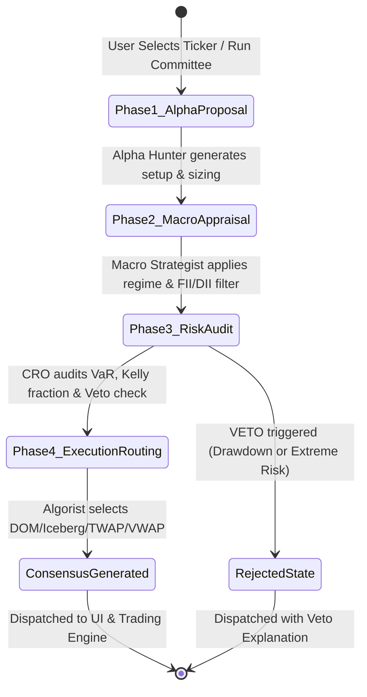

# Business Requirements Document (BRD)
## TradeCraft AI — Autonomous AI Quant Desk & Multi-Agent Virtual Hedge Fund War Room

- **Document ID:** `BRD-011-QUANT-DESK-HEDGE-FUND-WAR-ROOM`
- **Author:** Researcher Lead Agent
- **Status:** Approved for Backlog Decomposition & Engineering
- **Version:** 1.0.0
- **Target Release:** Sprint 11 (Autonomous Multi-Agent Intelligence & Institutional Quant Committee)
- **Dependencies:** 
  - Sprint 1 (`taxEngine.ts`, `tradingEngine.ts`, `aiProvider.ts`)
  - Sprint 4 (`replayEngine.ts` — Level-2 Market Depth DOM)
  - Sprint 5 (`analyticsEngine.ts` — Kelly Criterion & Monte Carlo Risk)
  - Sprint 6 (`breadthEngine.ts` — FII/DII Net Flows & Sectoral Heatmap)
  - Sprint 8 (`screenerEngine.ts` — Multi-Factor Confluence Screener)
  - Sprint 9 (`authService.ts` — User Accounts & Personas)
  - Sprint 10 (`leagueEngine.ts` & `proofEngine.ts` — Proof-of-Alpha Hash Ledger)

---

## 1. Executive Summary & Problem Statement

### 1.1 The Retail Quant Disconnect: Emotion vs. Institutional Separation of Concerns
In institutional hedge funds and proprietary trading desks (e.g., Renaissance Technologies, Millennium, Citadel, Point72), no single individual acts as researcher, risk manager, and executioner without oversight. Modern quantitative operations rely on **Strict Separation of Concerns**:
1. **The Solo Retail Trader Dilemma:** A retail trader who spots a breakout (acting as Alpha Hunter) immediately suffers from confirmation bias. They ignore macroeconomic liquidity headwinds (lack of Macro overlay), oversize the bet out of greed or revenge (lack of independent Risk Officer), and hit the market with an unhedged market order that suffers severe slippage (lack of Execution Algorist).
2. **The "Single-Prompt LLM" Hallucination Pitfall:** Generic retail AI tools offer a single prompt ("Analyze NIFTY"). Single-agent LLMs suffer from severe sycophancy, drift, and lack of internal adversarial friction. They frequently recommend taking excessive risk without calculating Value-at-Risk (VaR) or order-book liquidity constraints.
3. **The Educational Opportunity:** To master professional trading, retail traders, quants, and students must observe how a top-tier investment committee debates, red-teams trade proposals, enforces mathematical risk caps, and selects optimal execution algorithms (DOM Limit, Iceberg, TWAP, VWAP).

### 1.2 The TradeCraft AI Solution: Autonomous Multi-Agent Quant Desk
**Sprint 11** introduces the **Autonomous AI Quant Desk & Virtual Hedge Fund War Room**:
- **4 Autonomous Institutional Agents:**
  1. 🌐 **Macro Strategist (Top-Down Regime Analyst):** Ingests real-time market breadth (Advance/Decline), FII/DII institutional net flows, and Indian sectoral rotation indices from `breadthEngine.ts`.
  2. ⚡ **Momentum Alpha Hunter (Bottom-Up Setup Generator):** Ingests multi-factor screener signals, 15-minute Opening Range Breakouts (ORB), VWAP confluences, and volume surges from `screenerEngine.ts`.
  3. 🛡️ **Chief Risk Officer (Independent Risk & VaR Auditor):** Evaluates portfolio Value-at-Risk (99% VaR), Expected Shortfall (CVaR), Kelly Criterion sizing fractions, maximum drawdown limits, and margin concentration caps from `analyticsEngine.ts`. Has unilateral veto power.
  4. ⚙️ **Lead Execution Algorist (Microstructure & Routing Engineer):** Evaluates Level-2 DOM ladder bid/ask depth, calculates temporary and permanent market impact via the Almgren-Chriss model, and chooses the optimal execution route: **Direct DOM Limit**, **Iceberg Slicing**, **TWAP**, or **VWAP**.
- **Interactive Multi-Agent Debate War Room UI:**
  - A visual "Hedge Fund Boardroom" where users can trigger or watch autonomous debates on any NSE ticker.
  - Step-by-step structured debate transcript: Proposal $\rightarrow$ Macro Context $\rightarrow$ Cross-Examination & Red-Teaming $\rightarrow$ Risk Audit & Sizing Adjustments $\rightarrow$ Final Consensus Schema.
- **Dual Engine Execution Modes:**
  - **Deterministic Rule Engine (Instant / Zero-Cost):** Pure client-side mathematical consensus algorithm functioning offline without external API dependencies.
  - **Live BYOK Generative Debate Mode:** Synthesizes realistic, high-IQ dialogue and adversarial debate arguments using the trader's configured Gemini 2.5 Flash, OpenAI GPT-4o-mini, or local Ollama LLM.
- **Actionable Consensus Order Dispatch:**
  - Direct 1-click execution into the paper trading portfolio (`tradingEngine.ts`) with immediate cryptographic attestation in the Proof-of-Alpha ledger (`proofEngine.ts`).

---

## 2. Institutional Agent Personas & Mandates

```
                     ┌─────────────────────────────────────────────────────────┐
                     │          Virtual Hedge Fund Investment Committee        │
                     └────────────────────────────┬────────────────────────────┘
                                                  │
                 ┌────────────────────────────────┴────────────────────────────────┐
                 ▼                                                                 ▼
┌─────────────────────────────────┐                               ┌─────────────────────────────────┐
│     🌐 Chief Macro Strategist   │                               │    ⚡ Lead Momentum Alpha Hunter│
│     "Dr. Alistair Vance"        │                               │    "Vikram 'Alpha' Ray"         │
│ - Global cues & FII/DII Net Flow│                               │ - 15m Opening Range Breakouts   │
│ - Advance/Decline Market Breadth│                               │ - Volume Surge & VWAP Confluence│
│ - Sectoral Heatmap Rotation     │                               │ - Technical Confluence Scoring  │
└────────────────┬────────────────┘                               └────────────────┬────────────────┘
                 │                                                                 │
                 └───────────────────────────────┬─────────────────────────────────┘
                                                 │
                                                 ▼
                                 ┌─────────────────────────────────┐
                                 │    🛡️ Chief Risk Officer (CRO)   │
                                 │    "Elena Rostova"              │
                                 │ - 99% Parametric VaR & CVaR     │
                                 │ - Kelly Criterion Position Cap  │
                                 │ - Intra-day Drawdown Circuit    │
                                 │ - Absolute Veto / Size Haircut  │
                                 └─────────────────┬───────────────┘
                                                   │
                                                   ▼
                                 ┌─────────────────────────────────┐
                                 │  ⚙️ Lead Execution Algorist      │
                                 │  "Kavita Sundaram"              │
                                 │ - Level-2 DOM Depth Analysis    │
                                 │ - Almgren-Chriss Market Impact  │
                                 │ - Routing: DOM Limit / Iceberg /│
                                 │   TWAP / VWAP Slicing           │
                                 └─────────────────┬───────────────┘
                                                   │
                                                   ▼
                                 ┌─────────────────────────────────┐
                                 │   Actionable Consensus Schema   │
                                 │   + Proof-of-Alpha Attestation  │
                                 └─────────────────────────────────┘
```

### 2.1 Persona Specifications
| Persona | Name | Focus & Specialty | Key Metric / Domain | Authority |
| :--- | :--- | :--- | :--- | :--- |
| **Macro Strategist** | Dr. Alistair Vance | Macro liquidity, FII/DII institutional flows, sectoral rotation | $S_{\text{macro}} \in [-1.0, +1.0]$, A/D Ratio, Sector Spread | Sets market regime context; can downgrade risk appetite |
| **Momentum Alpha Hunter** | Vikram 'Alpha' Ray | Quantitative price action, multi-factor confluences, momentum | $C_{\text{score}} \in [0, 100]$, 15m ORB, RSI, VWAP delta | Proposes initial asset, side, target, and stop-loss |
| **Chief Risk Officer** | Elena Rostova | Capital preservation, fat-tail risk, ruin probability, sizing | $\text{VaR}_{99\%}$, Kelly fraction $f^*$, MaxDD cap | **Unilateral Veto Power**; haircuts quantities to safe bounds |
| **Execution Algorist** | Kavita Sundaram | Market microstructure, order book liquidity, slippage avoidance | Order book imbalance, Almgren-Chriss impact, Slicing | Selects routing protocol and schedule: DOM / Iceberg / TWAP / VWAP |

---

## 3. Mathematical Models & Analytical Formulations

### 3.1 Macro Regime Scoring Model ($S_{\text{macro}}$)
The Macro Strategist computes a composite regime score $S_{\text{macro}} \in [-1.0, +1.0]$:

$$S_{\text{macro}} = w_{\text{fii}} \cdot \Psi_{\text{norm}}(\text{Flow}_{\text{net}}) + w_{\text{breadth}} \cdot \left(\frac{A - D}{A + D}\right) + w_{\text{sector}} \cdot \bar{R}_{\text{sector\_rel}}$$

Where:
- $\text{Flow}_{\text{net}} = \text{Net}_{\text{FII}} + \text{Net}_{\text{DII}}$ (in ₹ Crores from `breadthEngine.ts`).
- $\Psi_{\text{norm}}(x) = \tanh\left(\frac{x}{2000}\right)$ maps net institutional flows between $-1.0$ and $+1.0$.
- $\frac{A - D}{A + D}$ is the standardized market breadth Advance/Decline oscillator.
- $\bar{R}_{\text{sector\_rel}} = R_{\text{target\_sector}} - R_{\text{NIFTY50}}$ measures sectoral outperformance.
- Default weights: $w_{\text{fii}} = 0.40, w_{\text{breadth}} = 0.35, w_{\text{sector}} = 0.25$.
- **Regime Classification:**
  - $S_{\text{macro}} \ge +0.35 \implies \textbf{Aggressive Risk-On}$ (Full sizing allowed).
  - $-0.20 \le S_{\text{macro}} < +0.35 \implies \textbf{Neutral / Selective}$ (Capped sizing).
  - $S_{\text{macro}} < -0.20 \implies \textbf{Defensive Risk-Off}$ (Long positions heavily penalized or rejected).

### 3.2 Momentum Alpha Confluence Model ($S_{\text{alpha}}$)
The Momentum Alpha Hunter aggregates technical confluences from `screenerEngine.ts`:

$$C_{\text{score}} = \sum_{k=1}^5 \omega_k \cdot \mathbb{I}_k$$

Where factors $\mathbb{I}_k$ represent:
1. **Volume Surge Factor:** $\mathbb{I}_{\text{vol}} = \min\left(\frac{V_{\text{current}}}{\text{SMA}_{20}(V)}, 3.0\right) / 3.0$
2. **Moving Average Alignment:** $\mathbb{I}_{\text{trend}} = 1.0$ if $\text{EMA}_9 > \text{EMA}_{21} > \text{EMA}_{50}$, else $0.0$
3. **VWAP Confluence:** $\mathbb{I}_{\text{vwap}} = 1.0$ if Price $> \text{VWAP}$ and $0 < \frac{P - \text{VWAP}}{\text{VWAP}} \le 1.5\%$
4. **15-Minute ORB Breakout:** $\mathbb{I}_{\text{orb}} = 1.0$ if current bar broke above 15m High with volume confirmation
5. **RSI Momentum Window:** $\mathbb{I}_{\text{rsi}} = 1.0$ if $55 \le \text{RSI}_{14} \le 72$ (bullish expansion without extreme exhaustion)

$$\text{Alpha Conviction} = \frac{C_{\text{score}}}{100} \in [0.0, 1.0]$$

### 3.3 Chief Risk Officer: VaR & Adjusted Kelly Sizing
The Chief Risk Officer enforces strict mathematical boundaries:

#### 1. Parametric Value-at-Risk ($\text{VaR}_{99\%}$)
$$\text{VaR}_{99\%} = V_{\text{position}} \times 2.326 \times \sigma_{\text{daily}} \times \sqrt{\frac{t_{\text{holding}}}{1}}$$
- If prospective $\text{VaR}_{99\%} > 2.0\%$ of total portfolio equity, the proposed quantity $Q_{\text{proposed}}$ is automatically scaled down:
  $$Q_{\text{var\_capped}} = Q_{\text{proposed}} \times \frac{0.02 \times \text{Equity}}{\text{VaR}_{99\%}}$$

#### 2. Regime-Adjusted Half-Kelly Sizing ($f^*_{\text{adj}}$)
Using the Kelly formulation from Sprint 5 (`analyticsEngine.ts`):
$$f^* = \frac{p \cdot b - (1 - p)}{b}, \quad f_{\text{half}} = \frac{f^*}{2}$$
The CRO scales the allowable capital allocation based on the Macro score:
$$f^*_{\text{adj}} = f_{\text{half}} \times \left( \frac{1 + S_{\text{macro}}}{2} \right)$$
$$\text{Max Capital Allowed} = \min\left( \text{Equity} \times f^*_{\text{adj}}, \, \text{Equity} \times 0.15 \right)$$
(Strict concentration limit: No single setup can exceed 15% of total portfolio equity).

#### 3. Unilateral Veto Conditions
The CRO asserts an immediate **VETO (`REJECTED_BY_RISK`)** if:
- Portfolio intraday drawdown is currently $\ge 6.0\%$ (Drawdown circuit breaker).
- Macro score $S_{\text{macro}} < -0.40$ and the Alpha Hunter proposes a LONG position.
- Asset 14-day annualized volatility $\sigma_{\text{ann}} > 65\%$ (excessive kurtosis/jump risk).

### 3.4 Lead Execution Algorist: Almgren-Chriss Market Impact & Routing

#### 1. Market Microstructure Assessment
The Algorist inspects the Level-2 Order Book (`replayEngine.ts`) to estimate available liquidity:
$$\text{Depth}_{\text{bid5}} = \sum_{j=1}^5 Q_{\text{bid}, j}, \quad \text{Depth}_{\text{ask5}} = \sum_{j=1}^5 Q_{\text{ask}, j}$$
$$\text{Book Imbalance} = \frac{\text{Depth}_{\text{bid5}} - \text{Depth}_{\text{ask5}}}{\text{Depth}_{\text{bid5}} + \text{Depth}_{\text{ask5}}}$$

#### 2. Almgren-Chriss Expected Slippage Formulation
$$\mathbb{E}[\text{Slippage}] = \frac{1}{2} \gamma \left(\frac{Q}{V_{\text{ADV}}}\right) + \eta \left(\frac{Q / N}{\tau \cdot \bar{q}_{\text{dom}}}\right)^{0.5}$$
Where:
- $\gamma$: Permanent impact coefficient
- $\eta$: Temporary impact coefficient
- $Q$: Total order quantity
- $N$: Number of sub-slices
- $\tau$: Time interval between slices (seconds)

#### 3. Algorithm Routing Decision Matrix
| Condition | Selected Routing Algorithm | Execution Profile |
| :--- | :--- | :--- |
| $Q \le 0.25 \times \text{Depth}_{\text{top5}}$ and Spread $\le 0.05\%$ | **Direct DOM Limit Ladder** | Routes directly to best bid/ask rung with zero slicing overhead |
| $0.25 \times \text{Depth}_{\text{top5}} < Q \le 1.0 \times \text{Depth}_{\text{top5}}$ | **Iceberg Slicing** | Slices into 4 to 8 randomized child orders with hidden reserve |
| $Q > 1.0 \times \text{Depth}_{\text{top5}}$ and Momentum is moderate | **TWAP (Time-Weighted)** | Slices evenly across $T$ minutes with Gaussian timing jitter |
| $Q > 1.0 \times \text{Depth}_{\text{top5}}$ and Volume curve is active | **VWAP (Volume-Weighted)** | Slices weighted by intraday Indian U-curve (NSE peak intervals) |

---

## 4. Multi-Agent Debate Protocol & Consensus State Machine

### 4.1 Four-Phase Debate Protocol



1. **Phase 1: Alpha Proposal (Momentum Alpha Hunter)**
   - Formulates directional hypothesis (LONG/SHORT), target price, stop-loss price, expected risk-reward ratio, and technical rationale.
2. **Phase 2: Macro Contextualization (Chief Macro Strategist)**
   - Challenges or validates hypothesis against institutional FII/DII net flows, market breadth, and sector beta. Adjusts conviction score.
3. **Phase 3: Adversarial Risk Audit (Chief Risk Officer)**
   - Computes 99% VaR, applies Kelly sizing, checks intraday drawdown rules. If rejected, sets `verdict: "REJECTED_BY_RISK"`. If approved, calculates maximum allowed safe shares.
4. **Phase 4: Algorithmic Routing & Slicing (Lead Execution Algorist)**
   - Inspects Level-2 DOM depth, evaluates market impact, selects routing strategy (`DOM_LIMIT`, `ICEBERG`, `TWAP`, `VWAP`), and configures child order slices.

### 4.2 Committee Consensus JSON Schema
```json
{
  "$schema": "http://json-schema.org/draft-07/schema#",
  "title": "QuantDeskConsensusVerdict",
  "type": "object",
  "properties": {
    "committeeSessionId": { "type": "string" },
    "timestamp": { "type": "number" },
    "symbol": { "type": "string" },
    "verdict": { 
      "type": "string", 
      "enum": ["APPROVED_FULL", "APPROVED_SCALED_DOWN", "REJECTED_BY_RISK", "REJECTED_BY_MACRO"] 
    },
    "directionalBias": { 
      "type": "string", 
      "enum": ["LONG", "SHORT", "NEUTRAL_HOLD"] 
    },
    "macroRegime": {
      "regimeScore": { "type": "number" },
      "regimeLabel": { "type": "string" },
      "fiiDiiNetFlowCr": { "type": "number" },
      "marketBreadthRatio": { "type": "number" },
      "strategistComment": { "type": "string" }
    },
    "alphaSignal": {
      "confluenceScore": { "type": "number" },
      "setupType": { "type": "string" },
      "entryPrice": { "type": "number" },
      "stopLossPrice": { "type": "number" },
      "targetPrice": { "type": "number" },
      "riskRewardRatio": { "type": "number" },
      "hunterComment": { "type": "string" }
    },
    "riskAudit": {
      "portfolioVar99Pct": { "type": "number" },
      "halfKellyFraction": { "type": "number" },
      "maxApprovedCapital": { "type": "number" },
      "approvedQuantity": { "type": "integer" },
      "originalQuantity": { "type": "integer" },
      "vetoTriggered": { "type": "boolean" },
      "vetoReason": { "type": "string" },
      "officerComment": { "type": "string" }
    },
    "executionPlan": {
      "routingAlgorithm": { 
        "type": "string", 
        "enum": ["DOM_LIMIT", "ICEBERG", "TWAP", "VWAP"] 
      },
      "sliceCount": { "type": "integer" },
      "sliceIntervalSec": { "type": "integer" },
      "estimatedSlippageBps": { "type": "number" },
      "estimatedStatutoryTaxes": { "type": "number" },
      "algoristComment": { "type": "string" }
    },
    "debateRounds": {
      "type": "array",
      "items": {
        "type": "object",
        "properties": {
          "agentId": { "type": "string" },
          "agentName": { "type": "string" },
          "role": { "type": "string" },
          "round": { "type": "integer" },
          "statement": { "type": "string" },
          "sentiment": { "type": "string", "enum": ["BULLISH", "BEARISH", "CAUTIONARY", "NEUTRAL"] }
        }
      }
    }
  },
  "required": ["committeeSessionId", "symbol", "verdict", "macroRegime", "alphaSignal", "riskAudit", "executionPlan", "debateRounds"]
}
```

---

## 5. System Architecture & Component Specifications

### 5.1 New Core Modules & Components

1. **`src/types/quantDesk.ts`:**
   - Defines `QuantAgentPersona`, `CommitteeSession`, `DebateRoundStatement`, `QuantDeskConsensusVerdict`, `ExecutionRoutingPlan`.
2. **`src/lib/quantDeskEngine.ts` (Core Engine):**
   - Implements the multi-agent consensus state machine.
   - Integrates `breadthEngine.ts` for macro regime score $S_{\text{macro}}$.
   - Integrates `screenerEngine.ts` for alpha confluence score $C_{\text{score}}$ and setup metrics.
   - Implements parametric $\text{VaR}_{99\%}$, Kelly sizing limits, and drawdown checks.
   - Implements Almgren-Chriss order book slicing heuristics for DOM/Iceberg/TWAP/VWAP.
   - Orchestrates deterministic debate synthesis and optionally passes context to `aiProvider.ts` for BYOK generative dialogue.
3. **`src/components/QuantWarRoomModal.tsx` (Interactive Boardroom UI):**
   - **Agent Podium / Avatar Bar:** Visual cards for Dr. Vance (Macro), Vikram Ray (Alpha), Elena Rostova (CRO), and Kavita Sundaram (Algorist), displaying real-time stance indicators (`BULLISH`, `BEARISH`, `VETO`, `OPTIMIZED`).
   - **Live Debate Chamber:** Interactive, sequential conversation stream highlighting claims, challenges, and risk counter-arguments.
   - **Executive Consensus Verdict Dashboard:**
     - Decision Badge (`APPROVED_FULL`, `APPROVED_SCALED_DOWN`, `REJECTED_BY_RISK`).
     - Sizing & VaR Metric Gauge.
     - Execution Routing Card (Slice count, interval, slippage).
     - 1-Click "Dispatch to Paper Trading Engine" button.
     - 1-Click "Export Consensus to Proof-of-Alpha".
4. **Header Navigation & Terminal Binding:**
   - Add **"🤖 Quant Desk"** button in `src/components/Header.tsx` with live indicator badge.
   - Synchronize active symbol between Chart Terminal, Screener, and Quant Desk.

---

## 6. Regulatory & Compliance Standards (SEBI Framework)

1. **SEBI Algorithmic Trading Framework (Circular SEBI/HO/MRD/DP/CIR/P/2018/101):**
   All algorithmic routing (Iceberg, TWAP, VWAP) simulated in TradeCraft AI adheres strictly to SEBI guidelines on price limits, order-to-trade ratios (OTR), and circuit breaker adherence.
2. **Educational Simulation & Risk Disclosure:**
   In compliance with SEBI advertising codes, the Quant Desk modal prominently displays:
   > *"Institutional Simulation Notice: The Autonomous Quant Desk simulates the decision-making protocol of an institutional investment committee. All agent statements, VaR calculations, and execution plans are strictly educational paper trading simulations. No real financial capital is traded."*
3. **Zero-Knowledge BYOK Guarantee:**
   When running in LLM-assisted debate mode, no user trade logs, account balances, or API keys are ever stored on centralized servers. All prompts execute client-side or directly between the user's browser and their configured LLM endpoint (Gemini, OpenAI, Ollama).

---

## 7. Acceptance Criteria & Test Verification Matrix

| AC ID | Criteria Description | Verification Method |
| :--- | :--- | :--- |
| **AC-QNT-01** | Macro Strategist calculates $S_{\text{macro}} \in [-1.0, +1.0]$ using FII/DII net flows, Advance/Decline ratio, and sector outperformance. | Automated unit test with positive, negative, and neutral market breadth inputs (`test/quantDeskEngine.test.mjs`). |
| **AC-QNT-02** | Momentum Alpha Hunter correctly generates technical confluence score and ORB/VWAP setup parameters. | Unit test verifying factor aggregation against known price/volume datasets. |
| **AC-QNT-03** | Chief Risk Officer strictly calculates parametric $\text{VaR}_{99\%}$, caps position size at Half-Kelly/concentration bounds, and asserts veto on drawdown breaches. | Unit test verifying quantitative size haircuts and veto triggering on drawdown breaches. |
| **AC-QNT-04** | Execution Algorist accurately computes DOM depth from Level-2 book and selects appropriate routing strategy (DOM Limit, Iceberg, TWAP, VWAP). | Unit test verifying algorithm selection across low, medium, and high liquidity order books. |
| **AC-QNT-05** | Consensus generator produces a valid, validated JSON verdict object adhering to `QuantDeskConsensusVerdict` schema. | Schema validation test verifying mandatory fields and typing. |
| **AC-QNT-06** | Interactive Quant War Room modal renders 4 agent avatars, live debate rounds, verdict card, and executes orders into `tradingEngine.ts`. | Component rendering test and user interactive workflow verification. |

---

## 8. Summary & Next Steps
**BRD-011** establishes the foundation for a groundbreaking educational experience: allowing individual traders and students to step inside a simulated multi-agent institutional hedge fund committee. By enforcing mathematical risk checks, multi-perspective debate, and optimal execution algorithms, TradeCraft AI directly addresses the psychological flaws that lead 93% of retail traders to incur losses.

Upon approval, this document will be indexed in `docs/brds/README.md` and handed over to the Scrum Master Agent for task decomposition in `docs/backlog.md`.
