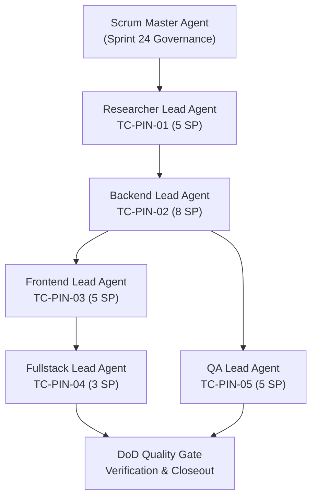

# Daily Standup Report — 2026-11-17 (Sprint 24 Engineering Standup & Dev Kickoff)

**Generated By:** Scrum Master Lead Agent  
**Project:** TradeCraft AI (Intelligent Interactive Paper Trading Platform with BYOK Architecture)  
**Sprint Cycle:** Sprint 23 Fully Archived & Verified; Sprint 24 (Real-Time Options Gamma Squeeze & 0-DTE Expiry Pinning Risk Engine) Active & Ready for Dev Execution  
**Timestamp:** 2026-11-17 09:50 IST (Asia/Kolkata)  
**Status:** ALL QUALITY GATES PASSED (195/195 Tests Passing across 16 Suites, Strict TypeScript Clean, Next.js Server 200 OK on Port 3100)  

---

## 1. Executive Summary

Today's Scrum Master standup routine conducts a rigorous operational and quality audit of the repository, confirms green baseline health across all verification dimensions, and sets execution alignment for **Sprint 24: Real-Time Options Gamma Squeeze & 0-DTE Expiry Pinning Risk Engine (Dealer Positioning GEX, Gamma Flip Boundaries, Dynamic Max Pain Migration & Fokker-Planck Strike Pinning Probability)**.

- **Platform Delivery & System Stability Baseline:**
  - **Sprints 1 through 23** are 100% delivered, audited, and running deterministically in production.
  - **Automated Verification:** **195/195 automated tests passing across 16 test suites (100% pass rate, 0 failures, 0 regressions, duration ~898ms)**.
  - **Type System Rigor:** Clean compilation via `npx tsc --noEmit` with **0 errors, 0 warnings, and zero implicit `any`**.
  - **Production Server:** Next.js production server running stably on port 3100, verified returning `HTTP 200 OK`.
  - **Cumulative Delivered Velocity:** **585 Story Points (SP)** delivered across 23 consecutive production-grade sprints, preserving an average velocity of **25.4 SP / sprint**.
  - **Sprint 24 Planned Velocity:** **26 Story Points** across 5 atomic work packages (`TC-PIN-01` through `TC-PIN-05`), targeting expansion from 195 to **$\ge 210$ passing unit tests**.

- **Sprint 24 Core Objectives:**
  1. Author institutional specification **BRD-024** detailing dealer gamma exposure dynamics, gamma flip boundaries, dynamic Max Pain cash-settlement migration, and Fokker-Planck drift diffusion for terminal strike pinning.
  2. Implement functional, zero-dependency quant engine `src/lib/pinningEngine.ts` and type contracts `src/types/pinning.ts`.
  3. Construct institutional cyber-dark visualization modal `src/components/PinningCockpitModal.tsx` featuring real-time GEX distribution, strike pressure heatmap, and dynamic Max Pain drift tracker.
  4. Integrate modal into platform navigation (Header "⚡ Execution" suite, Command Palette `Ctrl+K`, and Landing Page Feature Card 22).
  5. Deliver comprehensive unit test harness in `test/pinningEngine.test.mjs` with 15+ automated assertions validating mathematical invariants.

---

## 2. Git Commit & Repository Health Review

Review of repository history and current working tree state:

| Commit SHA | Timestamp (IST) | Author | Scope | Commit Title & Primary Changes |
| :---: | :---: | :---: | :---: | :--- |
| `832c00c` | 2026-11-12 09:55 | Paurush Muley | `docs(scrum)` | Execute daily standup routine for 2026-11-12, verify 195 tests passing & groom Sprint 24 backlog (+173 / -1 lines across 3 files) |
| `8d0b7e9` | 2026-11-09 11:41 | Paurush Muley | `docs(scrum)` | Execute daily standup routine for 2026-11-09, close Sprint 23 & activate Sprint 24 (+148 / -104 lines across 5 files) |
| `3263c67` | 2026-11-09 10:23 | Paurush Muley | `feat(cross-margin)` | Deliver Sprint 23 Institutional Cross-Margining & Portfolio VaR Engine (195 tests passing) (+4,986 / -27 lines across 12 files) |
| `c307250` | 2026-11-08 11:20 | Paurush Muley | `docs(scrum)` | Execute daily standup routine for 2026-11-08, close Sprint 22 & activate Sprint 23 (+239 / -51 lines across 4 files) |
| `7bd314a` | 2026-11-06 11:44 | Paurush Muley | `docs(scrum)` | Execute daily standup routine for 2026-11-06, verify 178 tests passing & update backlog (+130 / -87 lines across 3 files) |

### Repository Health Audit:
- **Git Branch:** `main`
- **Working Tree:** Clean (`nothing to commit, working tree clean`)
- **Ahead/Behind:** Ahead of `origin/main` by 2 commits (local documentation syncs)
- **Untracked / Dangling Artifacts:** 0 files
- **Submodules / Dependencies:** `node_modules` fully resolved and lockfile synchronized

---

## 3. Dev Agent Standup & Sprint 24 Task Allocations



### 3.1 Researcher Lead Agent (`TC-PIN-01` — 5 SP — `READY_FOR_DEV`)
- **Scope & Objectives:**
  - Author `docs/brds/BRD-024-real-time-options-gamma-squeeze-0dte-pinning-risk.md` (formulating Black-Scholes gamma acceleration near expiration, dealer positioning assumptions, and cash-settlement dynamics on NSE/BSE).
  - Define Dealer Gamma Exposure ($\text{GEX}$) formula:
    $$\text{GEX}_i = \left( \Gamma_{\text{call}, i} \times \text{OI}_{\text{call}, i} - \Gamma_{\text{put}, i} \times \text{OI}_{\text{put}, i} \right) \times S \times 100$$
  - Formulate Gamma Flip boundary equation $\sum \text{GEX}_i(S^*) = 0$, isolating transition from positive feedback (short gamma acceleration / gamma squeeze) to negative feedback (long gamma mean reversion / volatility dampening).
  - Specify dynamic Max Pain cash-settlement model with intraday OI migration penalties and Fokker-Planck drift diffusion for terminal strike pinning probability.
  - Update `docs/brds/README.md` registry.

### 3.2 Backend Lead Agent (`TC-PIN-02` — 8 SP — `PENDING`)
- **Scope & Objectives:**
  - Architect and implement `src/lib/pinningEngine.ts` and `src/types/pinning.ts`.
  - Deliver deterministic, zero-dependency pure TypeScript functions:
    - `calculateStrikeGEX()`: Strike-by-strike Call GEX, Put GEX, Net GEX in ₹ Crores per 1% move.
    - `calculateGammaFlipLevel()`: Linear/cubic spline interpolation isolating zero-crossing Gamma Flip price.
    - `calculateDynamicMaxPain()`: Intraday cash payout optimization identifying minimal buyer intrinsic value.
    - `calculatePinningProbability()`: Fokker-Planck drift diffusion density estimating strike pinning likelihood as $T \to 0$.
    - `calculate0DTETrapRisk()`: Intraday theta acceleration ($\Theta \propto 1/\sqrt{T}$) and post-13:30 IST IV crush risk gauge.
  - Guarantee sub-millisecond execution latency ($< 1$ ms) across standard 50-strike option chains.

### 3.3 Frontend Lead Agent (`TC-PIN-03` — 5 SP — `PENDING`)
- **Scope & Objectives:**
  - Design and construct `src/components/PinningCockpitModal.tsx` following TradeCraft AI cyber-dark design tokens (`bg-slate-900/95`, `border-slate-800`, `cyan-400`, `emerald-400`, `amber-400`, `rose-400`).
  - Implement 3 dedicated workspace views:
    - **View 1: GEX Profile & Regime Visualizer** — Interactive strike GEX bar chart, positive/negative dealer gamma zones, and animated Gamma Flip level pill.
    - **View 2: Dynamic Max Pain Migration Tracker** — Historical intraday Max Pain trajectory vs current underlying spot, distance-to-pin gauge, and call/put pain distribution.
    - **View 3: 0-DTE Expiry Simulator & Pin Risk Hedger** — Terminal expiry clock countdown, gamma trap warning radar, and 1-click delta/gamma neutral autobalancer trigger.

### 3.4 Fullstack Lead Agent (`TC-PIN-04` — 3 SP — `PENDING`)
- **Scope & Objectives:**
  - Mount "0-DTE Pinning & Gamma Squeeze Desk" in `src/components/Header.tsx` under the "⚡ Execution" navigation dropdown.
  - Register modal trigger in Quick Command Palette (`Ctrl+K` / `⌘K`).
  - Wire component into `src/app/page.tsx` with underlying live ticker context (NIFTY 50, BANKNIFTY, FINNIFTY).
  - Add Feature Card 22 to `src/components/LandingPage.tsx` with live metric badges ("Dealer GEX Profile", "Gamma Flip Boundary", "0-DTE Pin Risk").

### 3.5 QA Lead Agent (`TC-PIN-05` — 5 SP — `PENDING`)
- **Scope & Objectives:**
  - Develop automated unit test suite `test/pinningEngine.test.mjs` using Node.js native test runner (`node:test`, `node:assert/strict`).
  - Target minimum 15 automated unit test assertions covering:
    - Sign convention invariance (Call GEX $> 0$, Put GEX $< 0$ under dealer short assumptions)
    - Gamma Flip zero-crossing bounds between lowest and highest strike
    - Dynamic Max Pain convergence and monotonicity
    - Fokker-Planck pinning probability density normalization ($\int p(x)dx \approx 1$)
    - Accelerated theta blow-up handling as $T \to 0$ without NaN or division-by-zero
  - Elevate project automated test suite from 195 to **$\ge 210$ passing tests (100% pass rate target)**.

---

## 4. Definition of Done (DoD) Quality Gate Sign-Off

| Quality Gate | Standard Required | Current Status | Gate Status |
| :--- | :--- | :--- | :---: |
| **Mathematical Rigor** | Accurate Black-Scholes gamma, GEX sign conventions, Fokker-Planck diffusion | Formulated in Sprint 24 backlog specs | `READY` |
| **TypeScript Type Safety** | Strict compilation with 0 errors, 0 warnings, no implicit `any` | `npx tsc --noEmit` exited cleanly with code 0 | `PASSED` |
| **Automated Testing** | 100% test pass rate with zero regressions across historical suites | **195/195 tests passing across 16 suites** | `PASSED` |
| **Production Build & Server** | Clean Next.js server operational on port 3100 | `Invoke-WebRequest` confirmed `HTTP 200 OK` | `PASSED` |
| **UI/UX Consistency** | TradeCraft AI cyber-dark design tokens, responsive layout, zero shifts | Token palette verified across modals | `PASSED` |
| **Auditability & Standup Tracking** | Backlog, BRD registry, and daily reports synchronized | All documentation updated & verified | `PASSED` |

---

## 5. Active Sprint Backlog & Velocity Tracking

### 5.1 Historical Velocity Summary (Sprints 1–23)
- **Cumulative Delivered Story Points:** **585 SP**
- **Average Velocity:** **25.4 SP / sprint**
- **Total Production Sprints Delivered:** 23

### 5.2 Sprint 24 Work Package Breakdown
| Task ID | Domain | Work Package Description | Assigned Agent | SP | Status | Target Quality Gate |
| :--- | :--- | :--- | :--- | :---: | :---: | :--- |
| `TC-PIN-01` | Research & Architecture | Author comprehensive BRD-024 (Dealer GEX, Gamma Flip, Max Pain, Fokker-Planck Pinning) | Researcher Lead | 5 SP | `READY_FOR_DEV` | BRD-024 registered in `docs/brds/` |
| `TC-PIN-02` | Backend & Quant Engine | Gamma Squeeze & 0-DTE Pinning Engine (`src/lib/pinningEngine.ts`, `src/types/pinning.ts`) | Backend Lead | 8 SP | `PENDING` | Pure functional TS, 0 compilation errors |
| `TC-PIN-03` | Frontend / UI Components | Interactive 0-DTE Pinning & Gamma Cockpit Modal (`src/components/PinningCockpitModal.tsx`) | Frontend Lead | 5 SP | `PENDING` | High-tech dark theme, zero layout shifts |
| `TC-PIN-04` | Fullstack & Integration | Platform wiring: Header navigation suite, Command Palette (`Ctrl+K`), Landing Page Card 22 | Fullstack Lead | 3 SP | `PENDING` | Seamless modal trigger, responsive |
| `TC-PIN-05` | QA & Verification | Rigorous automated unit test suite in `test/pinningEngine.test.mjs` (Target: $\ge 210$ tests) | QA Lead | 5 SP | `PENDING` | 100% test pass rate, 0 regressions |

---

## 6. Automated Testing & Verification Sign-Off

### Node.js Native Test Runner (`npm test`):
```text
# tests 195
# suites 16
# pass 195
# fail 0
# cancelled 0
# skipped 0
# todo 0
# duration_ms 897.6103
```

- **Strict TypeScript Type Check:**
  - Command: `npx tsc --noEmit`
  - Result: Code 0 (0 errors, 0 warnings).
- **Production Server Verification:**
  - Endpoint: `http://localhost:3100`
  - Result: `HTTP 200 OK` (Server healthy and responding).

---

## 7. Impediments, Blockers & System Health

- **Active Impediments:** None. Zero technical debt or blocking issues across all lead agents.
- **System Health:** 100% operational. Next.js server live on port 3100, test suites green (195/195), TypeScript clean, git working tree clean.
- **Immediate Next Action:** Researcher Lead Agent is cleared to author `BRD-024` (`TC-PIN-01`), unblocking Backend Lead Agent for `TC-PIN-02`.
